<h1 align="center">KADADE MAHAMADOU Bassirou</h1>

  <b>Master 2 Systèmes d'Information et Systèmes Intelligents · INSEA Rabat</b> 
  Machine Learning · Traitement automatique du langage · Ingénierie logicielle

  
  
  

---

### À propos

Étudiant nigérien en Master 2 à l'**INSEA** (Rabat) et **boursier d'excellence de l'ICESCO**.
Je conçois des systèmes fiables, de la donnée au produit : modèles d'apprentissage automatique, IA générative et applications web et mobiles en production.
Mon objectif est de me spécialiser en **science des données** et de mettre l'IA au service des langues et des données africaines.

### Recherche en cours

<table>
<tr><td>

**Co-clustering de corpus textuels en haoussa pour la découverte non supervisée de thématiques en contexte de langue peu dotée**
 Octobre 2026 à janvier 2027 · Apprentissage non supervisé · Modèles de blocs latents · TAL des langues peu dotées

Le haoussa, langue véhiculaire du Niger, du nord du Nigeria et d'une large partie de l'Afrique de l'Ouest, est parlé par plusieurs dizaines de millions de personnes. Il reste pourtant une langue peu dotée : les corpus annotés y sont rares, et la plupart des travaux qui le concernent relèvent de l'apprentissage supervisé. Ce projet explore une autre voie. Le co-clustering partitionne simultanément les documents et les mots. Il associe ainsi à chaque groupe d'articles le vocabulaire qui le caractérise, et fait émerger les thèmes d'un corpus sans aucune étiquette.

L'étude compare de manière contrôlée six familles de co-clustering, que j'implémente à partir de leurs fondements (algorithmes EM et CEM), à des méthodes qui ne classent que les documents : K-means, NMF, LDA et le regroupement de représentations issues d'AfroXLMR. Elle examine ensuite si l'intégration de similarités sémantiques entre mots, apprises par un modèle de langue conçu pour les langues africaines, compense la parcimonie des données. Les expériences portent sur deux corpus publics aux textes de longueurs très différentes : les 3 173 articles de MasakhaNEWS en haoussa (7 thèmes) et les 2 917 titres de Hausa VOA Topics (5 thèmes). L'évaluation mesure la fidélité des partitions (NMI, ARI) et la cohérence des groupes de mots. Le code et le protocole seront publiés pour pouvoir être appliqués aux autres langues africaines.

</td></tr>
</table>

### Réalisations

| Projet | Cadre | Ce que j'ai réalisé | Technologies | Accès |
|:--|:--|:--|:--|:--|
| **Fiscalia** | Mission pour CGP Niger, 2026 à 2027 | Assistant fiscal fondé sur l'IA générative, qui produit des réponses sourcées et traçables à partir des textes fiscaux | LLM, RAG, embeddings, API sécurisée | Projet client |
| **NigerTax** | Mission pour CGP Niger, 2026 à 2027 | Plateforme fiscale en ligne, avec gestion des abonnements et des paiements | API REST, sécurité applicative | Projet client |
| **Horowa** | Stage en IA chez CGP Niger, 2026 | Module d'IA générative qui crée automatiquement des quiz et des questions-réponses pour la plateforme e-learning | LLM, prompt engineering, NLP | [horowa.net](https://horowa.net) |
| **StationPro** | Mission pour Station Africa, 2026 | Plateforme SaaS conçue de bout en bout pour gérer en temps réel le carburant, la boutique, la caisse et les crédits des stations-service, avec un journal d'audit complet | Next.js, React Native (Expo), WebSocket | [stationpro.app](https://stationpro.app) |
| **AfriProf School Admin** | Stage Full Stack chez Yanvision, 2025 | Plateforme d'administration scolaire, développée au sein d'une équipe | Vue.js (Quasar, Pinia), API REST | Projet d'entreprise |
| **Garden Paradise** | Stage chez ELKR Works, 2024 | Site de la résidence Garden Paradise à Bouznika, avec des pages responsives et une visite virtuelle à 360° | WordPress | [gardenparadise.ma](https://gardenparadise.ma) |
| **MyTopic** | Projet personnel | Génération automatique de présentations structurées à partir d'un simple sujet | Django REST, OpenAI API, React, TypeScript | [Code source](https://github.com/BassirouKadade/mytopic_backend) |
| **Shagona** | Projet personnel | Application Android de carnet de crédits destinée aux boutiques | React Native (Expo) | [Télécharger](https://bassiroukadade.github.io/shagona-app/) |

### Compétences

  

En **intelligence artificielle**, je maîtrise toute la chaîne de valeur. Elle va de l'apprentissage automatique et du deep learning au traitement du langage et aux grands modèles de langage, puis à l'IA générative avec RAG, aux agents et aux workflows automatisés, jusqu'à la mise en production et au suivi des modèles.
En **ingénierie logicielle**, je livre des applications web et mobiles complètes, des API en temps réel et des architectures SaaS déployées dans le cloud.
Les **données** font le lien entre ces deux mondes. Je les stocke, les transforme et les analyse pour qu'elles alimentent les modèles, et que les modèles enrichissent à leur tour les produits.

### Distinctions et certification

| Distinction | Organisme | Année |
|:--|:--|:--|
| **Bourse d'excellence** | ICESCO | 2025 à 2027 |
| **Bourse d'excellence** | AMCI, Agence Marocaine de Coopération Internationale | 2022 à 2024 |
| **Prix d'excellence et de mérite**, meilleur bachelier en informatique de la région de Niamey | Fondation NOUR | 2022 |
| **Certification** *Fundamentals of Deep Learning* | NVIDIA Deep Learning Institute | 2025 |

### Engagement

Je suis le fondateur d'**AB LOGIC**, une startup de services numériques spécialisée dans le développement d'applications, l'automatisation des workflows, les agents d'IA et l'analyse de données. En parallèle, j'ai été secrétaire général de l'**ANEM-Rabat** (2025 à 2026), où j'ai accueilli et orienté les nouveaux étudiants nigériens. Je suis aussi membre de l'équipe technique du **Club des Étudiants Internationaux** de l'INSEA.

---

Français · English · العربية

